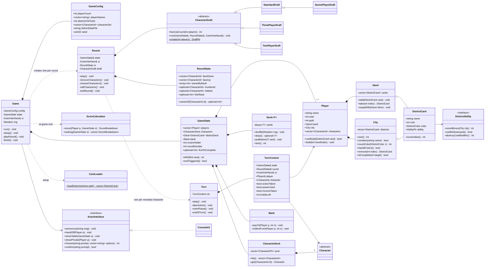
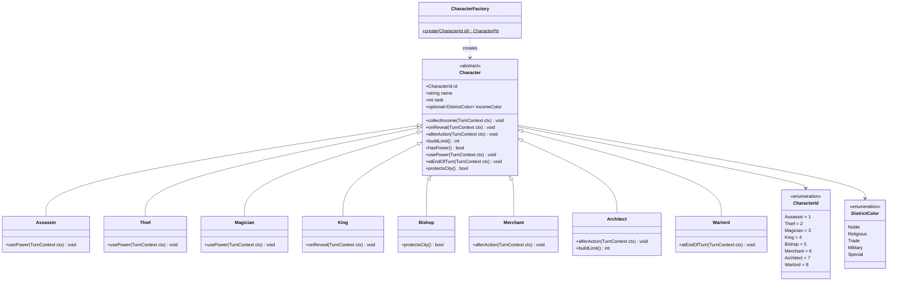
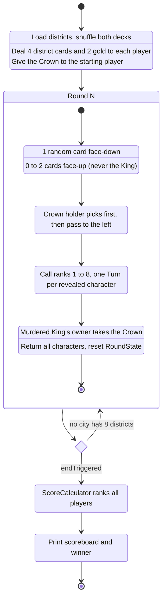
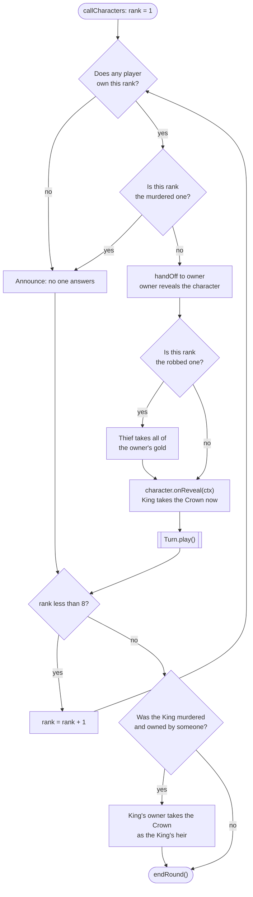
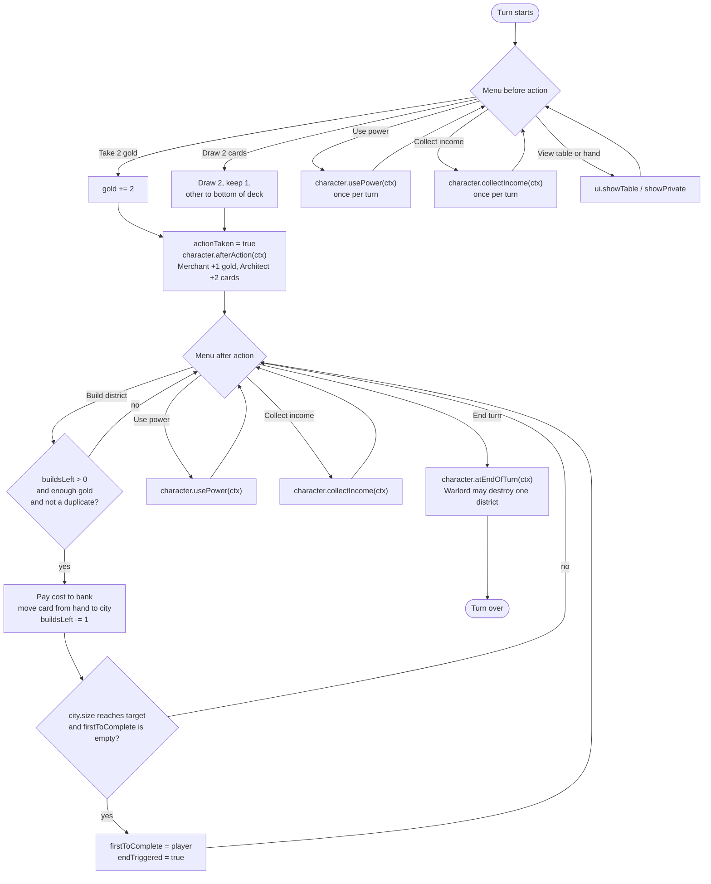
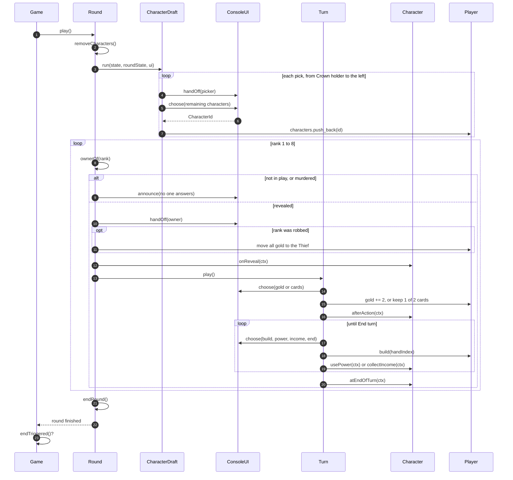
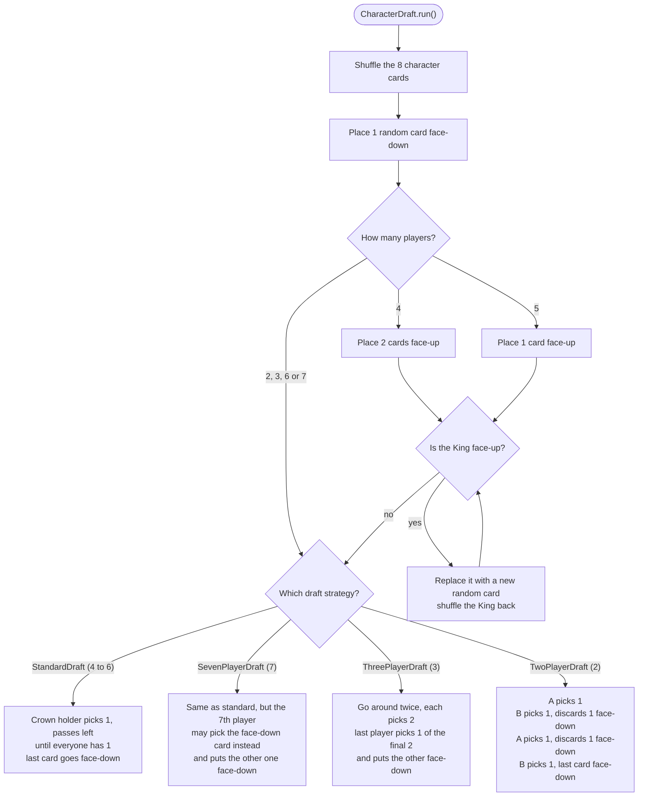
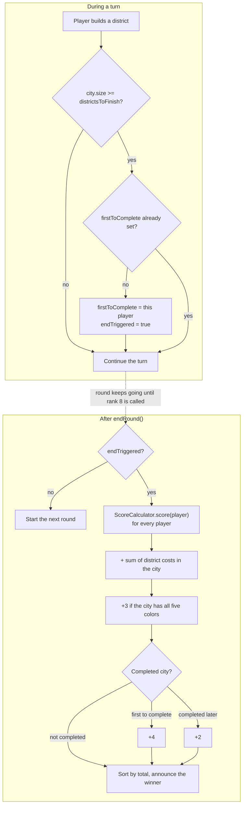

# Citadels — UML design

Diagrams for the C++ terminal edition (base game, 2–7 players, hot-seat). Sources live in `docs/uml/*.mmd` and render on GitHub.

## Class model

## Character hierarchy

## Game lifecycle

## Calling ranks in a round

## A player's turn

## One round as a sequence

## Character draft

## Endgame and scoring

